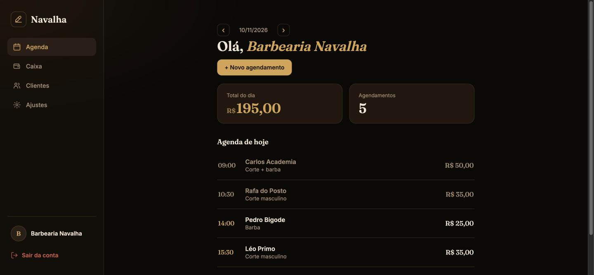
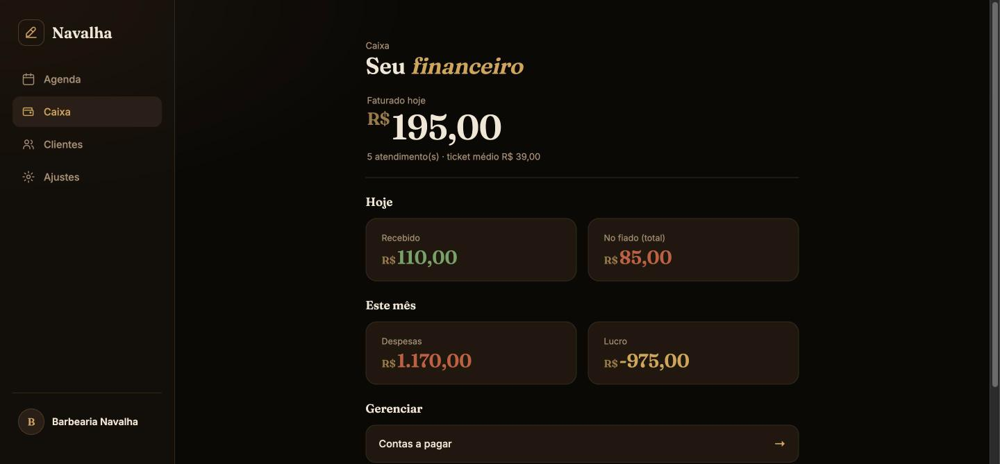
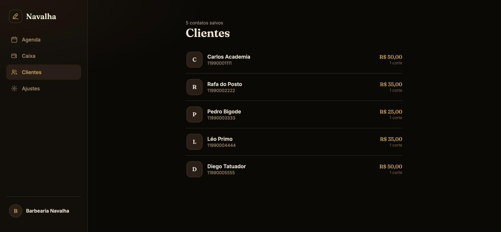

# 💈 Navalha — SaaS de Gestão para Barbearias

Sistema completo de gestão para barbearias: agendamento pelo WhatsApp, painel web, controle de caixa, fiado e contas a pagar. Cada barbearia é um cliente isolado do sistema (multi-tenant), com planos de assinatura.

**[🔗 Acessar a demonstração](https://projeto-barbearia-f330.onrender.com)**

> **Conta de demonstração:** `demo@navalha.com` / `demo123`
> (ou clique em **"Entrar com a conta demo"** direto na tela de login)
>
> A demo roda no plano gratuito do Render — a primeira abertura pode levar ~40s enquanto o servidor acorda.

---

## 📸 Telas

| Painel do dia | Caixa |
|---|---|
|  |  |

| Clientes |
|---|
|  |

---

## 🎯 O problema

Barbearia de bairro perde agendamento porque o barbeiro está cortando e não consegue responder o WhatsApp. E no fim do mês não sabe quanto entrou, quanto é fiado e quanto tem a pagar — está tudo num caderno.

O Navalha resolve os dois: **o cliente agenda sozinho pelo WhatsApp** (o bot responde 24h) e **o barbeiro vê tudo num painel** pelo celular.

---

## 🛠️ Stack

**Backend:** Java 21 · Spring Boot 4.1 · Spring Security 7 · Spring Data JPA · PostgreSQL
**Frontend:** Thymeleaf · HTML/CSS (responsivo, mobile-first)
**Integrações:** Twilio WhatsApp API
**Infra:** Docker (multi-stage) · Render · Neon (Postgres serverless)
**Docs:** OpenAPI / Swagger UI

---

## ✅ O que está funcionando

### Agendamento pelo WhatsApp
Bot conversacional que atende o cliente do começo ao fim — mostra os serviços, pega o horário, confirma e grava o agendamento no banco. Recebe as mensagens por **webhook** e responde em **TwiML**.

### Painel web (9 telas)
- **Login** — entrada com email e senha, ou direto na conta demo
- **Registro** — cadastro de uma barbearia nova, já escolhendo o plano
- **Agenda do dia** — navegação por data, status de cada agendamento
- **Novo agendamento** — criação manual pelo painel
- **Clientes** — histórico de cortes e quanto cada um já gastou
- **Caixa** — faturamento, recebido, ticket médio, nº de clientes
- **Fiado** — quem está devendo e quitação com 1 clique
- **Contas a pagar** — cadastro, vencimento e baixa
- **Ajustes** — CRUD de serviços e barbeiros

### Regras de negócio
- **Multi-tenancy** — cada barbearia só enxerga os próprios dados
- **Limite por plano** — plano `BASICO` permite 1 barbeiro; `PRO` é ilimitado
- **Choque de horário** — bloqueia agendamento em horário já ocupado
- **Fiado** — agendamento pode fechar como `PAGO` ou `FIADO`, e o fiado entra no "a receber"
- **Indicadores financeiros** — faturamento do dia, recebido, fiado, despesas do mês e lucro

---

## 🧠 Decisões técnicas

### Duas cadeias de segurança no mesmo app
O sistema atende dois tipos de cliente ao mesmo tempo, e cada um autentica de um jeito:

| | Telas (Thymeleaf) | API REST |
|---|---|---|
| **Quem usa** | barbeiro no navegador | bot do WhatsApp, Postman, futuro frontend |
| **Autenticação** | sessão + cookie | JWT no header |
| **Estado** | com sessão | `STATELESS` |

Resolvido com dois `SecurityFilterChain` separados por `@Order` + `securityMatcher`: o primeiro cuida de `/` e `/painel/**` com form login, o segundo cuida do resto com o filtro JWT. Assim o bot não precisa de cookie e a tela não precisa de token.

### Isolamento dos dados
Toda consulta é filtrada pela barbearia logada, que vem da sessão via `@AuthenticationPrincipal`. Nenhum endpoint aceita o `barbershopId` vindo do client — se aceitasse, bastaria trocar o número na URL pra ver os dados de outra barbearia.

### Deploy
`Dockerfile` multi-stage: um estágio com Maven pra compilar, outro só com o JRE pra rodar — a imagem final não carrega o Maven nem o código-fonte. Toda configuração sensível (banco, JWT, token do WhatsApp) vem de variável de ambiente, com valor padrão só pro ambiente local.

### Tratamento de erros
Exceções de domínio próprias (`ResourceNotFoundException`, `BusinessException`, `EmailAlreadyExistsException`) capturadas num `@RestControllerAdvice`, devolvendo resposta padronizada em vez de stack trace.

---

## 🗂️ Modelo de domínio

| Entidade | Papel |
|---|---|
| `Barbershop` | o tenant — dono da conta, tem plano |
| `Barber` | barbeiro da barbearia |
| `Client` | cliente final, identificado pelo telefone |
| `Service` | serviço oferecido (nome, preço, duração) |
| `Appointment` | agendamento — liga cliente, barbeiro e serviço |
| `Transaction` | entrada/saída do caixa |
| `Payable` | conta a pagar |

**Enums:** `Plan` (BASICO, PRO) · `AppointmentStatus` (AGUARDANDO, CONFIRMADO, CONCLUIDO, CANCELADO) · `PaymentStatus` (PAGO, FIADO) · `AccountStatus` (PENDENTE, PAGO, VENCIDO) · `TransactionType` (ENTRADA, SAIDA)

---

## 🚀 Rodando local

**Pré-requisitos:** Java 21, Docker

```bash
git clone https://github.com/samueloliveirz/projeto-barbearia.git
cd projeto-barbearia/barbearia

# sobe o Postgres
docker compose up -d

# roda a aplicação
./mvnw spring-boot:run
```

Abre em `http://localhost:8080` — a aplicação já cria a conta de demonstração com dados na primeira execução.

Documentação da API: `http://localhost:8080/swagger-ui.html`

### Variáveis de ambiente

Todas têm padrão pro ambiente local. Em produção, sobrescreva:

| Variável | Pra quê |
|---|---|
| `SPRING_DATASOURCE_URL` | URL do Postgres |
| `SPRING_DATASOURCE_USERNAME` | usuário do banco |
| `SPRING_DATASOURCE_PASSWORD` | senha do banco |
| `JWT_SECRET` | chave de assinatura dos tokens |
| `WHATSAPP_ACCESS_TOKEN` | token da API do WhatsApp |

---

## 📁 Estrutura

```
barbearia/
├── Dockerfile
└── src/main/
    ├── java/com/barbearia/
    │   ├── config/       # security, JWT, OpenAPI, seed da demo
    │   ├── controller/   # REST + telas (WebController) + webhook
    │   ├── dto/
    │   ├── enums/
    │   ├── model/        # entidades JPA
    │   ├── repository/
    │   └── service/      # regras de negócio
    └── resources/
        └── templates/    # telas Thymeleaf
```

---

## 🗺️ Próximos passos

- [ ] Testes automatizados (JUnit + Mockito)
- [ ] Migrar o frontend pra React
- [ ] Assinatura recorrente com Stripe
- [ ] Lembrete automático de agendamento pelo WhatsApp
- [ ] Relatório mensal em PDF

---

## 👤 Autor

**Samuel Oliveira**
[LinkedIn](https://linkedin.com/in/samueloliveirz) · [GitHub](https://github.com/samueloliveirz)
